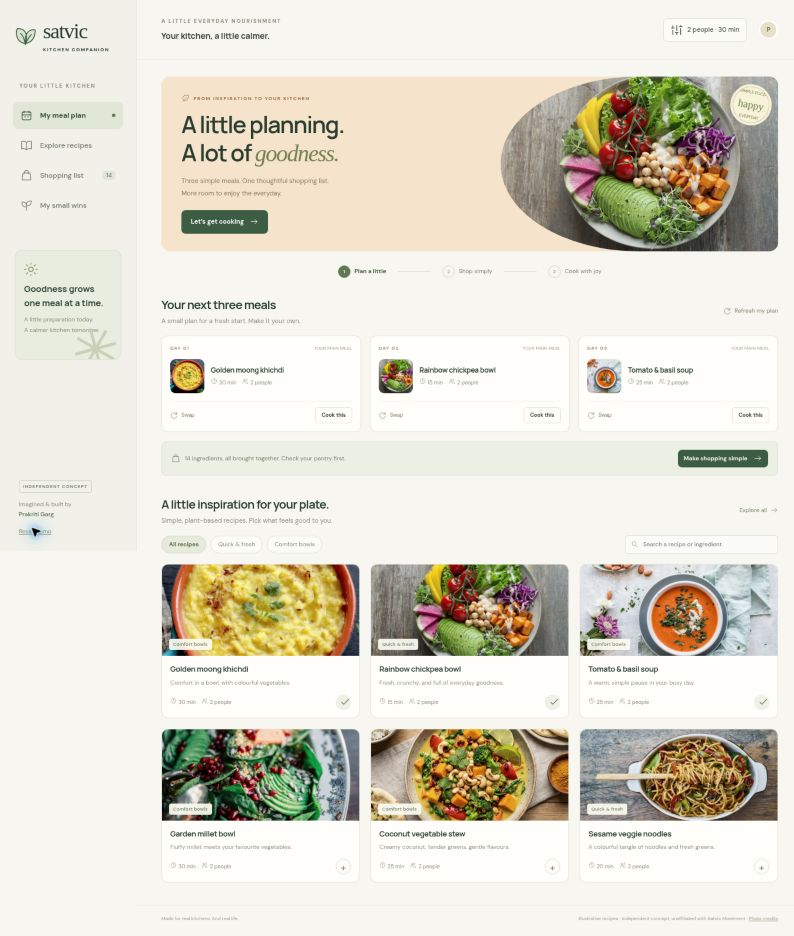

# Satvic Kitchen Companion

A calm, botanical kitchen-planning prototype: plan three meals, get one combined shopping list, cook step by step, and celebrate small wins.

An independent portfolio concept imagined and built by **Prakriti Garg**. Unaffiliated with Satvic Movement. Recipes are illustrative; see [photo credits](dist/credits.html).

## Run locally

Plain HTML, CSS and vanilla JavaScript — no build step.

```bash
cd dist
python3 -m http.server 4173
```

Then open http://127.0.0.1:4173/. Preferences, plans, pantry, purchases and progress are saved in the browser's localStorage.


